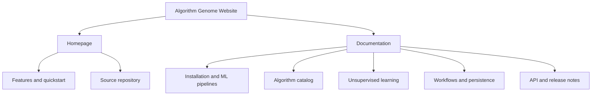

<div align="center">


# Algorithm Genome · Website

### A developer-first home for a machine-learning framework

**Explore the framework. Read the documentation. Build ML workflows.**

[](#-technology)
[](docs.html)
[](#-release-status)
[](#-publish-with-github-pages)

[**Explore homepage**](index.html) · [**Read docs**](docs.html) · [**Framework source**](https://github.com/samay722/Algorithm-Genome-1.0.0rc3-auto-models)

</div>

---

## ✨ What is this?

This repository contains the **public-facing website and documentation portal** for **Algorithm Genome** — a composable Python framework for machine-learning model selection, evaluation, and reusable workflows.

It is the **website**, not the Python package itself. The website is a dependency-free static project that can be hosted on GitHub Pages or another static hosting service.

<table>
<tr>
<td width="50%" valign="top">

### 🖥️ Landing page

- Overview of the framework
- Feature and capability highlights
- Copyable Python examples
- Clear links to documentation
- Responsive layout for mobile and desktop

**Entry point:** [`index.html`](index.html)

</td>
<td width="50%" valign="top">

### 📚 Documentation portal

- Installation & quickstart
- Model selection and algorithm catalog
- Unsupervised machine learning
- Graph workflows and checkpoints
- API, release scope, and safety notes

**Entry point:** [`docs.html`](docs.html)

</td>
</tr>
</table>

## 🧭 Website map



## 🚀 Run locally on Windows

No Node.js, npm, React, or build step is required. **Python is only used to serve the static files locally.**

Open PowerShell in the directory containing `index.html`, then run:

```powershell
py -m http.server 8000
```

Visit **http://localhost:8000/** in your browser. Documentation is available at **http://localhost:8000/docs.html**.

> If port 8000 is already in use, run `py -m http.server 8080` and open http://localhost:8080/.

## 🧩 Project structure

```text
Algorithm-Genome-Website/
├── index.html          # Landing page
├── docs.html           # Documentation shell
├── assets/
│   ├── logo.svg        # Logo
│   ├── styles.css      # Responsive styling
│   ├── site.js         # Navigation and copy buttons
│   └── docs.js         # Documentation content and search
└── README.md           # This file
```

## ⚙️ Technology

| Layer | Implementation |
|:--|:--|
| UI | HTML5 + CSS3 |
| Interaction | Vanilla JavaScript |
| Documentation | Client-side searchable reference |
| Branding | SVG logo |
| Hosting | Static hosting; no server runtime required |

## 🌍 Publish with GitHub Pages

1. Create a **public** GitHub repository for the **website** and push these files to its root.
2. Open the repository's **Settings → Pages**.
3. Under **Build and deployment**, select **Deploy from a branch**.
4. Choose **`main`**, select **`/ (root)`**, and click **Save**.
5. When GitHub Pages reports a published URL, open it and test the homepage, docs navigation, search, and copy controls.

For a repository named `Algorithm-Genome-Website` under user `samay722`, the **expected address after successful deployment** is:

`https://samay722.github.io/Algorithm-Genome-Website/`

This is a deployment convention, **not a claim that the site is currently live**.

## 🧪 Pre-launch checklist

- [ ] Homepage works on desktop and mobile
- [ ] All links target the intended repositories
- [ ] Documentation search and navigation work
- [ ] Code-copy buttons work
- [ ] Python quickstart snippets match the released package
- [ ] Framework version and release status are accurate
- [ ] Deployment URL is verified
- [ ] Website and framework license decisions are documented

## 📌 Release status

The site documents **Algorithm Genome `1.0.0rc3`**, a **release candidate**. It does not claim that this version is already available on PyPI. Package publication and production-readiness checks are separate from deploying the website.

## 🤝 Contributing

Suggestions, accessibility improvements, broken-link reports, and documentation corrections are welcome. Please provide the affected page, expected behavior, and steps to reproduce any issue.

---

<div align="center">

**Algorithm Genome** — *Machine learning, without the glue code.*

[Homepage](index.html) · [Documentation](docs.html) · [Framework source](https://github.com/samay722/Algorithm-Genome-1.0.0rc3-auto-models)

</div>
